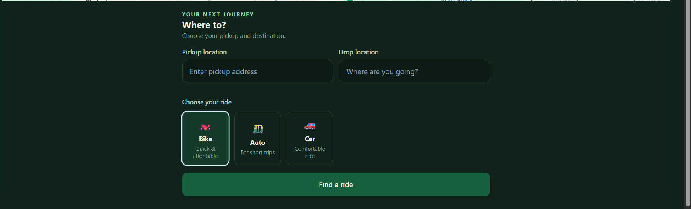
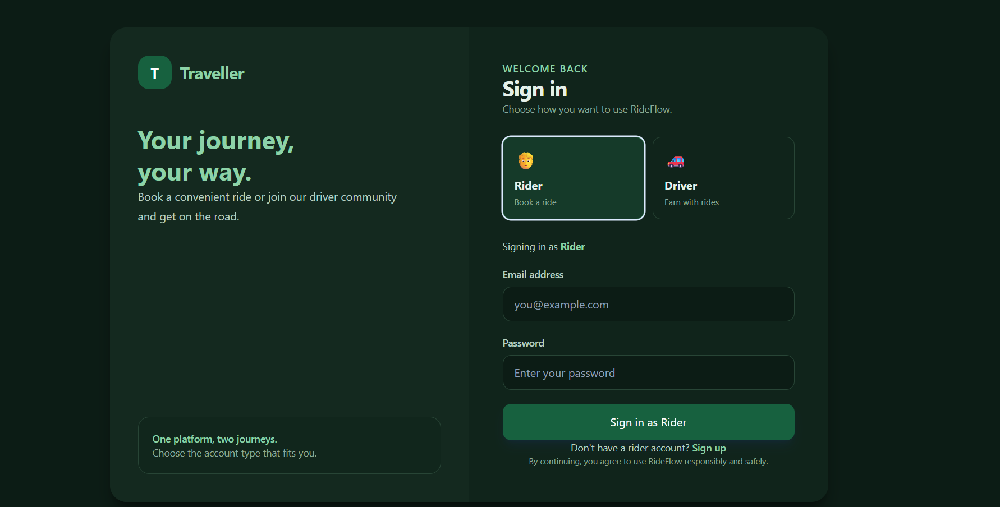
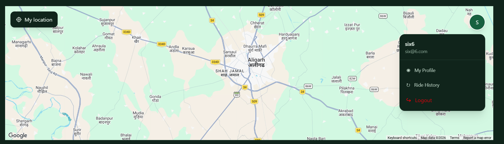
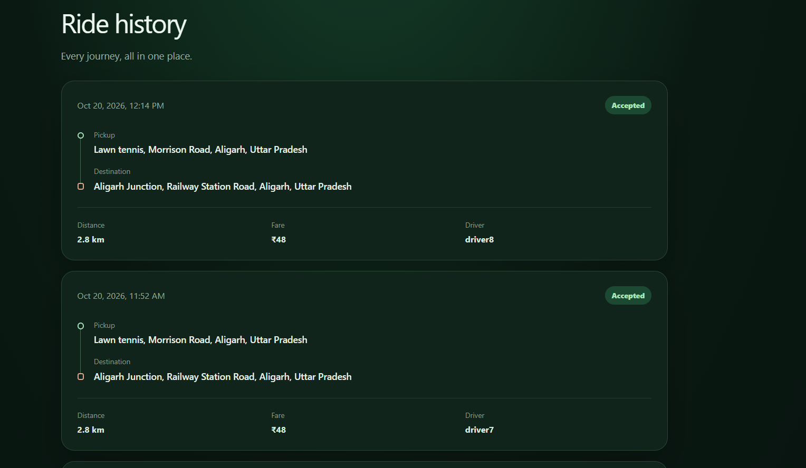

# Traveller — Ride-Sharing Platform

Traveller is a full-stack ride-sharing application designed to connect riders with nearby drivers. The project focuses on the core ride-booking workflow, real-time communication, location-aware driver discovery, trip management, and a responsive map-based interface.

> **Project status:** Core rider/driver flows are under development. The README distinguishes current functionality from planned improvements; update the checklist as features are tested and deployed.

## Screenshots

### Rider booking interface


### Sign in and choose an account type


### Map and profile menu


### Ride history


## Highlights

- **Two account types:** riders and drivers use role-specific authentication and dashboards.
- **Ride requests:** a rider selects pickup and destination locations, chooses a ride type, and requests a fare estimate.
- **Nearby-driver discovery:** the backend searches available drivers near the pickup point using MongoDB geospatial queries.
- **Route estimates:** Google Routes API can provide route distance and duration for fare estimation.
- **Real-time events:** Socket.IO carries ride requests, acceptance updates, trip events, and driver-location updates.
- **Ride history:** riders can review previous trips, including pickup, destination, distance, fare, status, and driver.
- **Persistent trip records:** accepted trips are stored in MongoDB.
- **Responsive UI:** a dark green visual theme, map-based experience, and rider/driver account selection.

## Technology stack

### Frontend
- React
- Vite
- Tailwind CSS
- React Router
- Redux Toolkit and React Redux
- Axios
- Socket.IO Client
- `@vis.gl/react-google-maps` for Google Maps

### Backend and infrastructure
The backend is maintained separately from this frontend repository.

- Node.js and Express
- MongoDB with Mongoose
- Socket.IO for bidirectional real-time events
- Redis for temporary pending-ride state and atomic request claiming
- Google Routes API for route distance and duration
- JWT-based authentication

## How the ride flow works

1. A rider signs in and chooses a pickup point and destination.
2. The frontend sends the coordinates to the backend. GeoJSON coordinates are stored in **`[longitude, latitude]`** order.
3. The backend finds a limited set of available drivers within the configured pickup radius using a MongoDB `2dsphere` index.
4. The backend obtains route details when the routing service is configured, calculates an estimated fare, and stores a short-lived pending ride request in Redis.
5. The backend emits a `ride_request` event to eligible drivers over Socket.IO.
6. A driver can accept the request. The backend atomically claims the pending request in Redis so that multiple drivers cannot normally claim the same request.
7. After acceptance, the backend creates a persistent trip record in MongoDB and notifies the rider and driver.
8. The rider and driver can join a trip-specific Socket.IO room for trip updates. Driver location updates can be relayed to that room.
9. Trip lifecycle actions (such as starting, completing, or cancelling a trip) update the trip state and should restore driver availability when appropriate.

Redis and MongoDB are separate systems, so a Redis claim and a MongoDB write are not one shared transaction. Production deployments should include recovery logic for failures between those operations.

## Repository structure

This repository contains the frontend application. A typical layout is:

```text
traveller-frontend/
├── public/
├── src/
│   ├── components/
│   ├── pages/
│   ├── services/
│   │   ├── api.js
│   │   └── socket.js
│   ├── store/
│   ├── App.jsx
│   └── main.jsx
├── docs/
│   └── screenshots/
├── .env.example
├── package.json
└── README.md
```

The exact folders may differ as the project evolves. The backend should be documented in its own repository.

## Getting started

### Prerequisites

- Node.js (use a current LTS release)
- npm
- A running Traveller backend
- A Google Maps JavaScript API key if using the Google Maps interface

### 1. Clone the repository

```bash
git clone https://github.com/shayan-05/traveller-frontend.git
cd traveller-frontend
```

### 2. Install dependencies

```bash
npm install
```

### 3. Configure environment variables

Create a `.env` file in the frontend root:

```env
VITE_BACKEND_API=http://localhost:8000/api/v1
VITE_GOOGLE_MAPS_API_KEY=your_google_maps_browser_key
```

Use the exact variable names expected by the code. Do not commit `.env` or real credentials.

**Google Maps key security:** a browser key is visible to users by design. Restrict it in Google Cloud Console to the required APIs and allowed website referrers. Enable billing only if required for the APIs you choose to use. Never put backend secrets, JWT signing keys, MongoDB credentials, or Redis credentials in a `VITE_` variable.

If your backend uses a different port or API prefix, update `VITE_BACKEND_API`. The backend must allow the frontend origin through its HTTP CORS and Socket.IO CORS configuration.

### 4. Start the development server

```bash
npm run dev
```

Open the local URL printed by Vite, usually `http://localhost:5173`.

### 5. Build for production

```bash
npm run build
```

To preview the production build locally:

```bash
npm run preview
```

## Backend integration

The frontend expects a backend that supports the routes and events used by the current application. Confirm the exact paths against the backend before deployment.

Examples of integration points include:

- Rider and driver signup/login endpoints
- Current-user endpoints for session restoration
- Ride-booking endpoint, such as `POST /api/v1/trip/book-ride`
- Rider ride-history endpoint
- Driver availability and location updates
- Socket.IO authentication and role-specific rooms

The frontend uses HTTP requests through its API service and a Socket.IO client for live events. For cookie-based authentication across different origins, configure secure cookie attributes correctly and enable credentialed CORS on the backend. If frontend and backend are hosted on different sites, cookie `SameSite` and `Secure` settings need special attention.

### Socket.IO events used by the ride workflow

The implementation uses events in the following areas (the exact payload shape should match the backend):

| Direction | Event | Purpose |
|---|---|---|
| Server → driver | `ride_request` | Notify a driver about a pending request |
| Driver → server | `accept_ride` | Ask the backend to accept a request |
| Server → rider | `ride_accepted` | Tell the rider that a driver accepted |
| Server → driver | `ride_acceptance_success` | Confirm acceptance to the driver |
| Server → other eligible drivers | `ride_request_taken` | Tell other drivers the request is no longer available |
| Server → rider/driver | `ride_started` | Notify that a trip started |
| Server → rider/driver | `ride_completed` | Notify that a trip completed |
| Server → rider | `ride_unavailable` | Notify that no driver accepted before expiry |
| Driver → server | `current_location` | Send a driver's latest coordinates |
| Server → trip room | `driver_location` | Broadcast driver coordinates for an active trip |
| Rider/driver → server | `join_trip` | Join a trip-specific room after authorization |

Treat these as an integration guide, not a substitute for checking the current backend handlers.

## Data and location conventions

- Google Maps commonly represents a coordinate as `{ lat, lng }`.
- GeoJSON uses coordinates in `[longitude, latitude]` order.
- Google Routes API uses `{ latitude, longitude }` fields.
- Keep these conversions explicit. Reversing latitude and longitude can produce incorrect locations and route results.
- A MongoDB geospatial query requires a correctly shaped GeoJSON `Point` and a `2dsphere` index on the queried field.
- Do not assume a driver's location is available until the driver has granted location permission and a valid location update has reached the backend.

## Security and reliability notes

Before a public launch:

- Enforce rider/driver authorization on every protected backend route and socket event.
- Do not trust a role stored in `localStorage` as proof of identity; it is only a frontend navigation hint.
- Use HTTPS in production and configure authentication cookies appropriately.
- Keep JWT secrets, MongoDB connection strings, Redis credentials, and server API keys on the backend only.
- Restrict the Google Maps browser key by website referrer and enabled APIs.
- Validate all coordinates, ride types, identifiers, and state transitions on the server.
- Prevent duplicate acceptance with atomic claiming and idempotent handlers.
- Add rate limits, request validation, structured logs, and error monitoring.
- Ensure a driver cannot accept a request that was not offered to them.
- Authorize access to trip rooms before allowing clients to join them.
- Add expiry and recovery handling for pending requests and failures between Redis and MongoDB operations.
- Avoid logging passwords, JWTs, or other credentials.

## Deployment overview

A typical deployment can use:

- **Frontend:** Vercel or another static hosting provider
- **Backend:** a Node.js host that supports long-lived WebSocket connections
- **Database:** MongoDB Atlas
- **Redis:** a managed Redis-compatible service
- **Maps:** Google Maps JavaScript API and Google Routes API, with suitable restrictions and billing configuration

Configure production environment variables on the hosting provider rather than committing them. Set the frontend API base URL to the deployed backend URL, and configure backend HTTP CORS and Socket.IO CORS to allow the deployed frontend origin. Verify WebSocket support, cookie behavior, and reconnect handling on the chosen host.

## Roadmap

The following are possible improvements, not claims that they are already implemented.

### Real-time location and dispatch
- [ ] Store frequently changing driver locations in Redis GEO structures (`GEOADD`, `GEOSEARCH`) to reduce repeated geospatial reads against MongoDB.
- [ ] Keep MongoDB as the durable source for driver profiles and, if needed, periodically persist location snapshots.
- [ ] Add location freshness timestamps and remove stale/offline drivers from dispatch results.
- [ ] Improve driver matching using ETA, vehicle type, driver availability, and distance.
- [ ] Add driver movement throttling, debouncing, and adaptive update frequency.
- [ ] Add reconnect recovery and rejoin authorized trip rooms after reconnect.

### Ride lifecycle and reliability
- [ ] Add a robust state machine for requested, accepted, started, completed, and cancelled rides.
- [ ] Add timeouts, retries, idempotency keys, and recovery for partially completed operations.
- [ ] Use an outbox/saga-style approach or reconciliation worker for Redis–MongoDB consistency.
- [ ] Add rider and driver cancellation policies and no-show handling.
- [ ] Add notifications when a request expires or no driver is found.
- [ ] Add transaction receipts and a clearer fare breakdown.

### Product improvements
- [ ] Add driver and rider profile editing.
- [ ] Add ratings, reviews, and trip feedback.
- [ ] Add saved places and address autocomplete.
- [ ] Add route polyline display, live ETA updates, and pickup/drop-off markers.
- [ ] Add ride filters, vehicle categories, and improved fare estimates.
- [ ] Improve mobile responsiveness, accessibility, loading states, and empty/error states.

### Engineering and operations
- [ ] Add automated unit, integration, and end-to-end tests.
- [ ] Add API documentation (for example, OpenAPI/Swagger).
- [ ] Add CI checks for linting, tests, and production builds.
- [ ] Add structured logging, metrics, tracing, and error reporting.
- [ ] Add load tests for ride requests, Socket.IO connections, and driver-location updates.
- [ ] Add Docker-based local development for frontend, backend, MongoDB/Redis dependencies where appropriate.
- [ ] Add a staging environment and deployment workflow.

## Contributing

Contributions and suggestions are welcome. For a change:

1. Create a feature branch.
2. Keep changes focused and document any new environment variables.
3. Test the relevant rider and driver workflows.
4. Run `npm run build` before opening a pull request.

## License

No license has been specified yet. Add a `LICENSE` file before presenting the project as open source.
